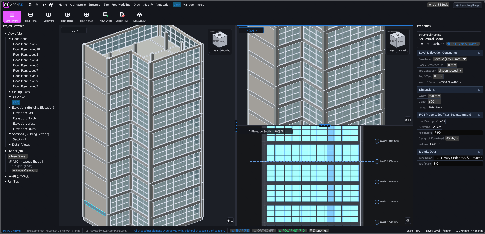

# Arch3D

<div align="center">

**A cleanroom, modern BIM authoring application powered by a high-performance pure Rust engine.**

[](https://www.rust-lang.org)
[](LICENSE)
[](https://technical.buildingsmart.org/standards/ifc/)
[](https://dsalesarchitect.github.io/arch3d/)
[](https://www.youtube.com/@OpenSourceArchitecture)
[](https://www.paypal.com/paypalme/dsalesarchitect)

<br><br>



</div>

---

## 🌟 Highlights

Arch3D offers a streamlined, developer-friendly architectural and structural modeler that delivers the core power of modern BIM authoring with the speed, memory safety, and simplicity of Rust.

- **Rust Engine**: Modular, dependency-light analytical geometry kernel and spatial document model.
- **Modern Ribbon Interface**: Intuitive top ribbon organized into **Architecture**, **Structure**, **Site**, **Free Modeling**, **Annotation**, **Modify**, **Manage**, and **Insert** panels.
- **Single Source of Truth**: All views—**Floor Plans**, **Reflected Ceiling Plans (RCP)**, **Building Elevations (N, S, E, W)**, **Building Sections**, **3D Axonometric/Perspective**, and **Detail Callouts**—are dynamically projected in real-time from a single central 3D building model.
- **Standard 1:1 Scale**: Every element is modeled at real-world scale in millimetres (`mm`), with customizable view scale representation (1:1 up to 1:1000).
- **ISO 10303-21 IFC4 Standard File Format**: Full export and import support for buildingSMART IFC4 schema (`IfcProject`, `IfcSite`, `IfcBuilding`, `IfcBuildingStorey`, `IfcWall`, `IfcColumn`, `IfcBeam`, `IfcSlab`, `IfcCovering`, `IfcDoor`, `IfcWindow`, `IfcCurtainWall`, `IfcRoof`, `IfcStair`, `IfcRamp`, `IfcRailing`, `IfcFooting`, `IfcExtrudedAreaSolid`, `IfcRelAggregates`, and `IfcRelContainedInSpatialStructure`).
- **CAD & Mesh Ingestion**: Reads `.dwg`/`.dxf` via `acadrust` and SketchUp `.skp` via `openskp` without proprietary SDKs.
- **Hardware GPU Viewport**: Direct OpenGL hardware depth-buffered rendering (`glow`) with 24-bit Z-buffer and 4x MSAA.
- **Live Sync & Interoperability**: glTF 2.0 Binary (`.glb`) export, WebGPU path tracing studio (`@meimu/mutracer`), and Blender Live Sync bidirectional socket bridge.
- **Zero-Install Web Studio**: Full WebAssembly client compiled with `wasm-bindgen` and deployable directly to GitHub Pages.

---

## 🏛 Workspace Architecture

```text
arch3d/
├── crates/
│   ├── plinth-geom/     # Geometry kernel: 2D/3D vectors, AABBs, affine transforms,
│   │                    # ear-clipping polygon triangulation, prism solids, clipping.
│   │
│   ├── plinth-model/    # Central Single Source of Truth BIM model:
│   │                    # Elements (Wall, Column, Beam, Slab, Ceiling, Door, Window,
│   │                    # Dimension, DetailLine), Levels, Grids, Materials, Undo/Redo.
│   │
│   ├── plinth-views/    # Multi-view projection engine:
│   │                    # Floor Plan (cut plane at 1200mm, door swing arcs, glazing),
│   │                    # Reflected Ceiling Plan (RCP tile grid), Elevations (N/S/E/W),
│   │                    # Section cuts (solid slicing & hatching), 3D shaded view, Details.
│   │
│   ├── plinth-ifc/      # Standards-compliant IFC4 STEP physical file exporter and parser
│   │                    # (ISO 10303-21) with buildingSMART 22-char GUID compression.
│   │
│   └── plinth-app/      # Interactive desktop application (egui / eframe):
│                        # Ribbon bar, Project Browser tree, Properties inspector,
│                        # interactive viewport canvas with grid snapping and tool state machine.
```

---

## 🎛 Ribbon Tools

### 1. Architecture
- **Wall**: Architectural partition and exterior walls with real-time thickness and length feedback.
- **Door**: Hosted single-flush door with 90° swing arc, opening cutouts, and flip options.
- **Window**: Hosted fixed/casement window with sill lines, jambs, and glazing centerlines.
- **Column**: Architectural column with rectangular or circular profile.
- **Floor**: Floor slabs with polygonal boundary editing and layer thickness.
- **Ceiling**: Suspended acoustic tile and gypsum ceiling systems with customizable tile grids.

### 2. Structure
- **Structural Column**: Load-bearing concrete and steel column framing.
- **Beam**: Structural framing beams with start/end elevations and depth profiles.
- **Structural Wall**: Reinforced shear and foundation walls.
- **Structural Slab**: Ground foundation and suspended structural floor slabs.

### 3. Draw & Annotate
- **Detail Line**: 2D drafting lines (Thin, Medium, Wide, Hidden).
- **Dimension**: Aligned linear dimensions with witness lines, slash ticks, and measured text.
- **Grid**: Datum grid lines with circular bubble tags (1, 2, 3... / A, B, C...).

### 4. Modify
- **Select**: Pick elements to inspect or edit.
- **Move**: Two-point base and destination translation.
- **Rotate**: Interactive center and angle rotation.
- **Mirror**: Axis reflection across any two points.
- **Delete**: Instant deletion of selected elements with full Undo/Redo support.

### 5. Manage
- **Project Information**: Project name, project number, client, and address.
- **Levels Manager**: Add, adjust, and inspect building storeys and elevations.
- **Materials**: Concrete, Masonry Brick, Structural Steel, Glass, Drywall, and Timber.

### 6. Insert
- **Export IFC4**: Generates standard ISO 10303-21 `.ifc` physical files compatible with Revit, Solibri, BlenderBIM, and BIMcollab.
- **Import IFC4**: Reads standard IFC4 building storeys, walls, columns, and slabs.
- **Sample Model**: One-click generation of a complete 2-storey office building.

---

## 🚀 Quick Start

### Build and Run

```bash
# Clone the repository
git clone https://github.com/dsalesarchitect/arch3d.git
cd arch3d

# Check workspace
cargo check --workspace

# Run all unit and projection tests
cargo test --workspace

# Run Arch3D Desktop
cargo run --bin arch3d
```

### Windows One-Click Launcher
Double-click `Launch-Arch3D.bat` in the repository root.

### Web Studio (GitHub Pages)
Test live in your browser without installation: [https://dsalesarchitect.github.io/arch3d/](https://dsalesarchitect.github.io/arch3d/)

---

## 📐 Single Source of Truth Projection Engine

In Arch3D, every building element is stored once in 3D world space at standard 1:1 scale (mm):
$$\mathbf{X}_{world} = (x, y, z) \in \mathbb{R}^3$$

When viewing the model:
1. **Floor Plan**: Slices the model at $Z_{cut} = Z_{level} + 1200\,\text{mm}$. Cutting solids are filled with cut hatch and outlined with heavy cut line weights. Door swing arcs and window sill geometry are generated.
2. **Reflected Ceiling Plan (RCP)**: Looks upwards from $Z_{cut} = Z_{level} + 2300\,\text{mm}$, rendering ceiling boundary perimeters and tile module grid lines (e.g. $600 \times 600\,\text{mm}$).
3. **Elevations**: Orthographically projects exterior faces onto North, South, East, and West planes with level datum markers and heavy ground lines.
4. **Sections**: Slices model prisms against arbitrary vertical cutting lines $(S_1, S_2)$, computing mathematically exact cut polygons and background projection lines.
5. **3D View**: Directional sunlight shading ($I = 0.45 + 0.55 \max(0, \mathbf{n} \cdot \mathbf{l})$), back-face culling, depth sorting, and crisp architectural edge linework.

---

## 🏗 BIM Level of Development (LOD) Roadmap & Current State

Arch3D aligns with the international **AIA G202 / BIMForum Level of Development (LOD)** industry specification:

| Level | Definition | Arch3D Implementation & Capabilities | Status |
| :--- | :--- | :--- | :--- |
| **LOD 100** | Conceptual Massing | Site boundary lot polygons, building pads, toposolids, massing volumes, gross floor area. | 🟢 **Core Engine** |
| **LOD 200** | Schematic Assemblies | Parametric elements with live dimensions, datum grids, storeys, generic walls/slabs/doors/windows. | 🟢 **Core Engine** |
| **LOD 300** | Specific Assemblies & Quantities | True 1:1 mm watertight 6-sided solid B-Reps, compound assemblies with thermal U-values, ISO 10303-21 IFC4 Psets. | 🟢 **ACTIVE BASELINE** |
| **LOD 350** | System Coordination & Interfaces | Mitered wall corners, beam-to-column analytical ray trimming, bay slab inner-face beam attachments, hosted curtain wall cutouts. | 🟢 **ACTIVE BASELINE** |
| **LOD 400** | Fabrication & Detailing | Automated 3D rebar cages, bar bending schedules, structural steel connection plates, bolts, CNC fabrication exports. | 🟡 **Planned (Plugins)** |
| **LOD 500** | As-Built & Facility Management | Scan-to-BIM point cloud comparison, COBie facility management tabular data, IoT telemetry digital twin. | 🔵 **Future Lifecycle** |

### 🔍 Current Feature Readiness (v0.1.0)

- **🟢 Production-Ready & Validated (100% Operational in Core)**:
  - **3D Solid Geometry**: 18 core architectural/structural primitives with 1:1 mm analytical B-Rep solids and compound multi-layer assemblies.
  - **Dynamic Multi-View Projections**: Single Source of Truth Floor Plans (1200mm cut plane), RCP, 4 Elevations, arbitrary Section cuts, and 3D Axonometric views.
  - **GPU Hardware Viewport**: 24-bit depth testing with 4x MSAA, directional sunlight shading, and translucent glazing passes.
  - **Open Industry Exchange**: buildingSMART IFC4 STEP export/import, AutoCAD DWG/DXF ingestion (`acadrust`), SketchUp SKP mesh ingestion (`openskp`), and glTF 2.0 Binary (`.glb`) export.
  - **Interoperability & Sheets**: Bidirectional Blender Live Sync socket bridge, WebGPU Path Tracing Studio (`@meimu/mutracer`), multi-sheet layouts, and vector PDF export.
  - **Snapping & Automation**: Full CAD snapping (Endpoint, Midpoint, Perpendicular, Center, Nearest, Ortho, Polar 15°/30°/45°), multi-storey replication, and automatic bay framing.
- **🟡 In Active Development (Near-Term Pipeline)**:
  - Automated cross-compilation pipeline for native macOS (Apple Silicon/Intel) and Linux desktop binaries (Windows x64 and WebAssembly are fully active).
  - External dynamic `.wasm` runtime plugin sandboxing.
  - Automated tabular Bill of Quantities (BOQ) CSV/Excel schedule export.
- **🔴 Not Yet Implemented (LOD 400+ Roadmap)**:
  - 3D structural rebar reinforcement cages (planned via structural plugin).
  - Steel connection plates, cleats, and bolt assemblies.
  - MEP (Mechanical, Electrical, Plumbing) duct and pipe routing.
  - Multi-user real-time cloud worksharing / central file checkout.

---

## 💖 Community & Sponsorship

Arch3D is developed as open-source software for the global AEC community. Voluntary contributions, sponsorships, and channel memberships directly support independent CAD/BIM engine development, IFC4 certification testing, and native cross-platform builds.

- 📺 **Official YouTube Channel**: Watch dev logs, release demos, and architectural BIM tutorials at [@OpenSourceArchitecture](https://www.youtube.com/@OpenSourceArchitecture).
- ⭐ **YouTube Membership**: Join as a channel member for community perks and direct support at [YouTube Channel Membership](https://www.youtube.com/@OpenSourceArchitecture/join).
- 💖 **GitHub Sponsors**: Back ongoing development and continuous testing infrastructure via [GitHub Sponsors](https://github.com/sponsors/dsalesarchitect).
- ☕ **PayPal Donation**: Send an instant one-time contribution directly via [PayPal.me](https://www.paypal.com/paypalme/dsalesarchitect).

---

## 📄 License

Arch3D is open-source software licensed under the **GNU General Public License v3.0 or later (GPL-3.0-or-later)** with the **Arch3D Commercial Plugin Exception** (see [LICENSE](LICENSE)).

- The core Arch3D application, its source code, and derivative works are protected under the GNU General Public License v3.0 or later.
- Under the **Arch3D Commercial Plugin Exception** (GNU GPLv3 Section 7), third-party and author plugins, modules, scripts, and add-ons communicating via the plugin API, WebAssembly interface, or socket/IPC bridges may be developed, distributed, and monetized under proprietary, commercial, or alternative terms without requiring the plugin itself to be open-sourced.

All contributions are welcome! Please see [CONTRIBUTING.md](CONTRIBUTING.md).
